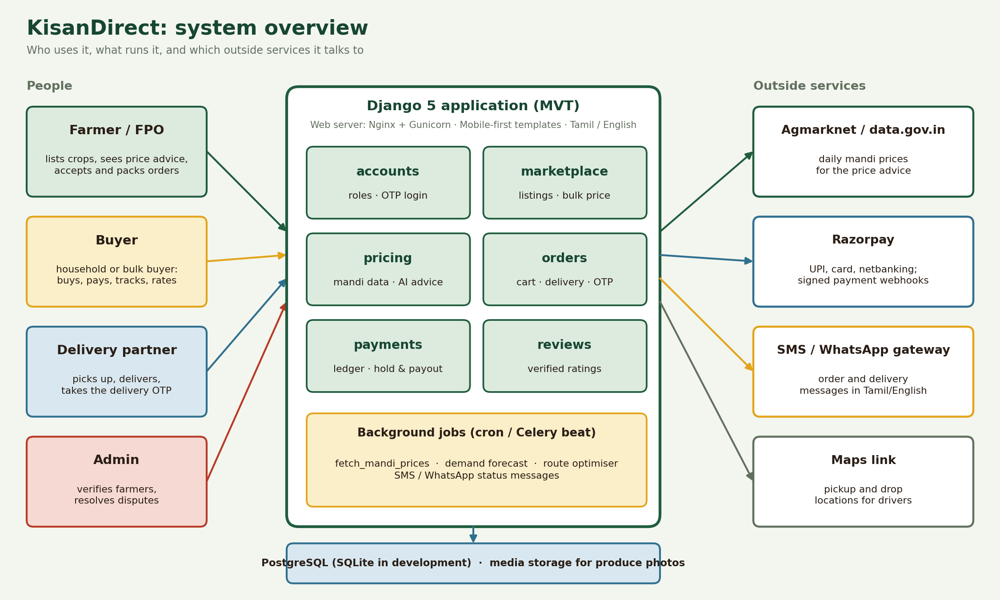

# Smart India Hackathon Workshop
# Date: 27/10/2026
## Reference Number: 26018201
## Name: AMIRTHAN T

## Problem Title
SIH 26033: Multiple intermediaries reduce farmers earnings and increase consumer prices.

## Problem Creater's Organization
Ministry of Consumer Affairs, Food & Public Distribution

## Theme
Agriculture, FoodTech & Rural Development

## Problem Description
Expected Solution: Create a digital marketplace that:

• Connects farmers/FPOs directly with consumers and bulk buyers.
• Provides logistics support.
• Uses AI for demand forecasting and route optimization.

Benefits:

• Better prices for farmers.
• Lower prices for consumers.
• Reduced supply chain inefficiencies.


## Proposed Solution

**KisanDirect** is a Django web app where a farmer lists a harvest in under a minute, in **Tamil or English**, at **their own price**, and a buyer pays and receives it directly. There is no mandi agent or wholesaler in between.

**The five things it does**

1. **Simple, bilingual farmer interface.** Big buttons, icons next to every label, three short steps to list a crop, and a Tamil/English switch on every page. The farmer never sees a menu longer than four items.
2. **Bulk listing at the farmer's own price.** The farmer enters crop, quantity (kg, quintal or tonne), price per unit, minimum bulk order and optional photo. An optional bulk price applies from a set quantity.
3. **AI price advice from the real market.** Before publishing, the farmer sees a clear verdict: **price too high, fair, or too low**, with the nearest mandi prices that explain it and a suggested range. The farmer can ignore the advice and publish anyway.
4. **Direct buying with ratings.** Customers and bulk buyers search, filter by district and crop, order, and later rate the farmer and the produce. Only buyers whose order was delivered can rate.
5. **Delivery and transactions.** The buyer gives a delivery address and phone, pays by UPI/card (or cash on delivery for small orders), and tracks the order. Money is held by the platform and released to the farmer after the buyer confirms delivery with an OTP. Every payment, refund and payout is recorded in a transaction ledger.

**How it addresses the problem**

| Problem | What KisanDirect does |
|---|---|
| Intermediaries take the margin | Farmer sells straight to the buyer; platform fee is a small, visible percentage paid by the buyer |
| Farmer doesn't know if the price is right | AI price advice compares the farmer's price with current mandi prices before publishing |
| Language and literacy barriers | Tamil-first interface, icons, large type, optional voice input |
| Buyers don't trust unknown sellers | Verified-purchase ratings, farmer village and district, harvest date on every listing |
| Farmers fear non-payment | Buyer pays up front; money is released after delivery is confirmed |

**Innovation and uniqueness**
- A price verdict in the farmer's own language **at the moment of listing**, based on real mandi data, not a generic price list.
- Ratings tied to delivered orders only, so they cannot be faked.
- Payment held until delivery is confirmed by OTP, protecting both sides.
- One simple codebase (Django) that a college team can build, run and extend.

## Technical Approach

**Technologies**
- **Backend and frontend:** Python 3 and **Django 5** (Model-View-Template). Server-rendered templates with plain CSS and a little JavaScript; no separate frontend framework.
- **Database:** SQLite for development, PostgreSQL for production.
- **Language switching:** Django's built-in internationalization (`LocaleMiddleware`, `gettext`, `.po` files for Tamil).
- **Payments:** Razorpay (UPI, cards, netbanking) with server-side signature verification.
- **Market data:** Agmarknet daily mandi prices, published as open data on data.gov.in.
- **Images:** Pillow with Django `ImageField` (photo of the produce).
- **Scheduling:** a daily `cron` job or Celery beat for fetching prices.
- **Deployment:** Gunicorn + Nginx on any small cloud VM.

**Django project layout (MVT)**

```
kisandirect/
├── config/                 settings.py, urls.py
├── accounts/               User (farmer / buyer / delivery partner), profile, OTP login
├── marketplace/            Product listing, search, bulk pricing, photos
├── pricing/                MandiPrice data, price advice (the AI part)
├── orders/                 Cart, Order, delivery address, delivery status, OTP on delivery
├── payments/               Transaction ledger, Razorpay, payout release
├── reviews/                Ratings and comments (verified purchase only)
├── locale/ta/LC_MESSAGES/  Tamil translations (django.po)
├── templates/              base.html + one folder per app
└── static/                 css, js, icons, Tamil web font
```

| MVT layer | Role in this project |
|---|---|
| **Model** | `User`, `Product`, `MandiPrice`, `Order`, `OrderItem`, `Transaction`, `Review` |
| **View** | `ListProduct`, `PriceAdvice`, `Checkout`, `ConfirmDelivery`, `RateOrder`, payment webhook |
| **Template** | Simple pages with big buttons; every text wrapped in `` |
| **URLconf** | `config/urls.py` includes each app; language-prefixed URLs via `i18n_patterns` |

### 1. Simple interface in Tamil and English

- Enable `django.middleware.locale.LocaleMiddleware`, set `LANGUAGES = [("en", "English"), ("ta", "தமிழ்")]` and `LOCALE_PATHS = [BASE_DIR / "locale"]`.
- Wrap every label in `` (Tamil: **பயிரை பட்டியலிடுங்கள்**) and every Python message in `gettext_lazy`. Run `makemessages -l ta`, translate the `.po` file, run `compilemessages`.
- Put a two-button **தமிழ் | English** switch in `base.html`. It posts to Django's built-in `set_language` view and the choice is remembered in the session and saved on the user profile.
- Default language is Tamil for farmer accounts, English for buyers.
- Use the **Noto Sans Tamil** font, 18 px minimum body size, high contrast, and an icon on every action (camera for photo, rupee for price, truck for delivery).
- **Listing in three steps** on one screen: (1) pick the crop from picture tiles, (2) enter quantity and price, (3) see the price advice and tap **Publish**. Quantity and price use number keypads on mobile.
- Optional voice input: the browser's Web Speech API fills the price and quantity fields (support for Tamil depends on the device, so typing always works).
- The site works on low-end phones: pages are light, and the layout is mobile-first.

### 2. Bulk listing at the farmer's own price

`Product` fields: `farmer`, `crop`, `description`, `unit` (kg / quintal / tonne), `quantity_available`, `price_per_unit` (set by the farmer), `min_order_qty`, `bulk_min_qty`, `bulk_price_per_unit` (optional), `harvest_date`, `district`, `photo`, `status`.

- A form validates that price and quantity are positive and that the bulk price is not above the normal price.
- Quantity is reserved inside `transaction.atomic()` with `select_for_update()` at checkout, so two buyers can never buy the same stock.

### 3. AI price suggestions from the actual market

**Data.** A management command, `python manage.py fetch_mandi_prices`, runs daily and stores the latest Agmarknet records (crop, mandi, district, date, minimum, maximum and modal price per quintal) in the `MandiPrice` table. The page shows when prices were last updated.

**Method.**
1. Take the farmer's crop and district; find mandi prices for the last 7 days from the **nearest mandis** (same district first, then the state).
2. Convert quintal prices to the farmer's unit and compute a **reference price** (the median of recent modal prices) and a **range** (low and high quotes).
3. Compare the farmer's price with the reference:

```python
def price_advice(crop, district, price_per_kg):
    quotes = recent_modal_prices(crop, district, days=7)      # ₹/kg, nearest mandis first
    if len(quotes) < 3:
        return {"verdict": "unknown"}                         # say so; never guess
    ref = median(quotes)
    ratio = price_per_kg / ref
    verdict = "high" if ratio > 1.15 else "low" if ratio < 0.90 else "fair"
    return {"verdict": verdict, "reference": ref,
            "suggested_low": round(ref * 0.95, 2), "suggested_high": round(ref * 1.12, 2),
            "mandis_used": len(quotes)}
```

4. Show a coloured verdict in the farmer's language, for example:
   - **Fair** (green): "உங்கள் விலை சரியானது" / "Your price is fair."
   - **High** (orange): "உங்கள் விலை சந்தையை விட அதிகம்; விற்பனை மெதுவாகலாம்" / "Your price is above the market; it may sell slowly."
   - **Low** (red): "உங்கள் விலை குறைவு; நீங்கள் அதிகம் பெறலாம்" / "Your price is below the market; you could earn more."
   - Beneath it: the reference price, the suggested range, and the mandis it came from.
5. **Direct sales can fairly price above the mandi price**, because the buyer still pays less than the retail price. The fair band is therefore set slightly above the mandi reference, not equal to it.

**Learning from the platform itself.** As orders accumulate, the advice also uses how fast similar listings sold (for example "listings priced 10% above market took twice as long to sell") and a simple weekly demand forecast from past orders. The logic starts rule-based, which is explainable and needs no training data, and can later move to a regression or time-series model behind the same function.

**Optional.** A language model can write the one-line explanation in simple Tamil. The verdict and numbers always come from the data, never from the model.

### 4. Direct buying, ratings and reviews

- **Buyer flow:** browse or search → product page (photo, price, farmer, village, harvest date, rating) → quantity → checkout.
- **Buyer types:** household buyers and bulk buyers (shops, hotels). Bulk buyers see the bulk price automatically when their quantity passes `bulk_min_qty`.
- **Ratings:** `Review(order, buyer, farmer, product, stars 1-5, comment, created_at)`. The form is only available when `order.status == "delivered"`, and a `unique(order)` constraint allows one review per order. Product and farmer pages show the average and the number of reviews.
- **Trust badges:** "Verified farmer" (checked by an admin), "Harvested 2 days ago", "120 orders delivered".

### 5. Delivery details and tracking

`Order` fields: `buyer`, `farmer`, `items`, `delivery_name`, `phone`, `address`, `district`, `pincode`, `latitude`, `longitude`, `status`, `delivery_partner`, `delivery_otp`.

| Status | Who changes it |
|---|---|
| Placed → Accepted | Farmer taps **Accept** |
| Accepted → Packed | Farmer taps **Packed** |
| Packed → On the way | Delivery partner picks it up |
| On the way → Delivered | Buyer gives the 4-digit OTP to the delivery partner |
| Placed → Cancelled | Buyer or farmer, before packing; stock is restored |

- The buyer and farmer each get an SMS or WhatsApp message at every status change (via an SMS gateway).
- Delivery partners (local drivers or FPO vehicles) sign in with a delivery role and see packed orders in their area with the pickup and drop addresses and a map link.
- **Route optimisation:** when a driver selects several orders, a nearest-neighbour + 2-opt routine orders the stops (farms first, then customers) to minimise distance.

### 6. Transaction system

`Transaction(order, kind [payment | refund | payout | fee], amount, status, gateway_reference, created_at)` is an append-only ledger.

```
Buyer pays (Razorpay UPI/card) ──▶ webhook verified ──▶ Transaction(payment, success)
             │
             ▼
   Money held by the platform
             │
   Buyer confirms with delivery OTP
             ▼
Transaction(fee)   platform fee, 2% paid by the buyer
Transaction(payout) 100% of item value sent to the farmer's UPI/bank account
             │
   Dispute or cancellation ──▶ Transaction(refund)
```

- Payment confirmation happens only in the **server-side webhook**, after verifying Razorpay's signature. The browser's "payment done" message is never trusted.
- Farmer bank/UPI details are stored once on the profile; payouts happen after delivery. For the hackathon prototype the payout step can be recorded in the ledger and settled manually, and automated later with Razorpay Route or payouts.
- Cash on delivery is allowed for small orders only and is marked as paid when the OTP is confirmed.
- Every farmer gets an **Earnings** page: orders, amount received, amount pending.

**Methodology and implementation plan**

| Step | What is built | Output |
|---|---|---|
| 1 | Django project, `accounts` with farmer / buyer / delivery roles, Tamil-English switch | Sign up and language working |
| 2 | `marketplace`: three-step listing form, bulk fields, photo upload, search and filters | Farmer can publish a crop |
| 3 | `pricing`: `fetch_mandi_prices`, `price_advice`, verdict card in the listing form | Price advice before publishing |
| 4 | `orders`: cart, checkout, address, status flow, delivery OTP, SMS | Buyer can order and track |
| 5 | `payments`: Razorpay checkout, webhook, ledger, payout release | Money flow end to end |
| 6 | `reviews`: verified ratings, averages, trust badges | Ratings visible on listings |
| 7 | Driver view with route optimisation; demand forecast on the farmer page | Logistics support and forecasting |
| 8 | Tests, Tamil review by a native speaker, usability test with real farmers, deploy | Ready demo |

**Working prototype:** a Django project with the models, views and templates above; demo accounts for farmer, buyer and delivery partner; seeded mandi prices so the advice works offline during the demo.

## Feasibility and Viability

**Feasibility.** Django, SQLite/PostgreSQL, gettext translations and Razorpay are mature and well documented. The full loop (list → advise → buy → deliver → pay → rate) can be built by a small team. Agmarknet prices are open government data, so no paid data source is required.

**Potential challenges and risks**
- Mandi data can be missing for some crops or districts, or update late.
- Many farmers have limited smartphone skills and patchy internet.
- Machine-translated Tamil can sound unnatural or wrong.
- Buyers may not trust unknown farmers; farmers may fear late payment.
- Fake or low-quality produce and fake reviews.
- Last-mile delivery is costly for small orders in remote villages.
- Payments and payouts need KYC and bank verification.

**Strategies to overcome them**
- If fewer than three recent quotes exist, the app says "not enough market data" instead of guessing; it falls back to state-level prices and shows the date of the data.
- Onboard through FPOs and field agents who can list on a farmer's behalf; keep screens light and tolerant of slow connections; add WhatsApp and voice options.
- Have Tamil text reviewed by native speakers and by farmers during a usability test.
- Verified-farmer badges, harvest dates, photos, reviews limited to delivered orders, and money held until delivery is confirmed.
- Set minimum order values and pool deliveries by area and day, so a driver carries several orders per trip.
- Use Razorpay's KYC flow and keep payments server-verified; keep an auditable ledger.

## Impact and Benefits

**Potential impact on the target audience**
- **Farmers and FPOs:** set their own price, know whether it is right before listing, sell in bulk, and get paid directly, in their own language.
- **Consumers and bulk buyers:** buy fresh produce straight from the farm, see who grew it, read genuine ratings, and avoid retail mark-ups.
- **Delivery partners:** steady local work with efficient routes.

**Benefits**
- **Economic:** a larger share of the final price stays with the farmer; buyers pay less than retail; faster, safer payment.
- **Social:** inclusion of Tamil-speaking and low-literacy farmers, transparent pricing, trust through ratings, stronger FPOs.
- **Environmental:** shorter supply chains, optimised delivery routes, and less spoilage because supply is matched to demand.

## Research and References
1. Agmarknet, Agricultural Marketing Information Network (daily mandi prices): https://agmarknet.gov.in
2. Open Government Data Platform India, "Current Daily Price of Various Commodities from Various Markets (Mandi)": https://data.gov.in
3. eNAM, National Agriculture Market: https://enam.gov.in
4. Django documentation, internationalization and localization: https://docs.djangoproject.com/en/5.0/topics/i18n/
5. Django documentation, models, views, templates and transactions: https://docs.djangoproject.com
6. Razorpay documentation, payment gateway, webhooks and signature verification: https://razorpay.com/docs
7. SFAC, Small Farmers' Agribusiness Consortium (FPO promotion): https://sfacindia.com
8. Hyndman & Athanasopoulos, *Forecasting: Principles and Practice* (exponential smoothing): https://otexts.com/fpp3
9. Croes, G. A. (1958), *A method for solving traveling-salesman problems* (2-opt)
